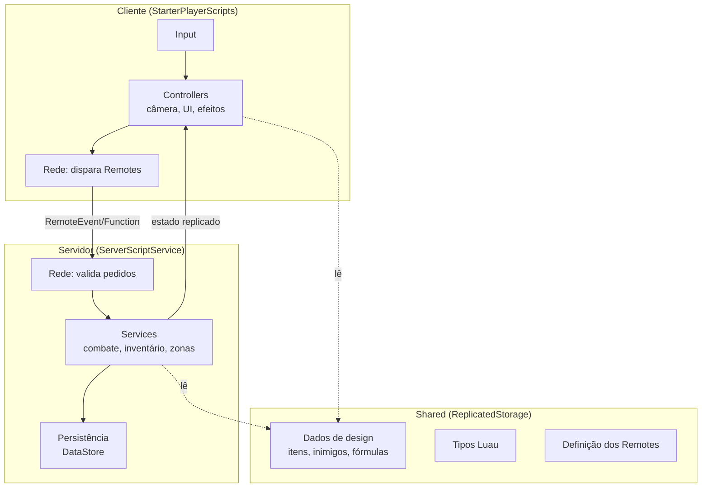

# Visão Arquitetural

Visão de alto nível de **como o jogo é construído**. Os detalhes ficam na [estrutura do repositório](ESTRUTURA-DO-REPOSITORIO.md), nas [convenções](CONVENCOES-DE-CODIGO.md) e nas decisões registradas em [`adr/`](adr/).

## Princípios
1. **O servidor é a fonte da verdade.** O cliente pede, o servidor decide. ([ADR-002](adr/ADR-002-servidor-autoritativo.md))
2. **O código fica fora do Studio.** Git + Rojo; o `.rbxl` é artefato, não fonte. ([ADR-001](adr/ADR-001-desenvolvimento-externo-com-rojo-e-git.md))
3. **Uma responsabilidade por módulo.** Cada ModuleScript resolve um problema.
4. **Dados de design separados da lógica.** Stats de itens, inimigos e zonas ficam em módulos de configuração (`src/shared/Config/`), não espalhados no código.
5. **Tipagem estrita.** Luau `--!strict` sempre que possível. ([ADR-003](adr/ADR-003-luau-em-modo-strict.md))

## Visão geral (proposta)

## Camadas (proposta)
| Camada | Onde roda | Responsabilidade |
| --- | --- | --- |
| **Services** | Servidor | Regras do jogo e estado autoritativo |
| **Controllers** | Cliente | Input, câmera, UI, efeitos visuais e sonoros |
| **Shared** | Ambos | Tipos, constantes, dados de design, funções puras |
| **Rede** | Fronteira | Remotes e validação de payload |
| **Persistência** | Servidor | Salvar e carregar o perfil do jogador |

## Decisões em aberto
- [ ] Usar um framework, ou um *loader* simples do projeto, para iniciar Services e Controllers? Proposta do dev, já implementada na US-007: o loader simples `src/shared/Loader.luau` (Init de todos, depois Start), fácil de trocar por um framework. Falta o Davi confirmar.
- [ ] Persistência: DataStore puro ou uma biblioteca com *session locking*? (ADR-005, a escrever)
- [ ] Rede: Remotes puros ou um wrapper tipado? (sai da US-005) Proposta do dev, já implementada na US-005: Remotes puros criados pelo servidor a partir da lista única em `src/shared/Remotes.luau`, e todo pedido passa por `src/server/Rede.luau` (limite por segundo e validação). Falta o Davi confirmar.
- [ ] Topologia do mundo: um place com tudo ou um place por zona? (ADR-004, a escrever)
- [ ] Instâncias de dungeon: no mesmo servidor ou em *reserved servers*? (ADR-007, a escrever)
- [ ] Itens como instâncias com `uid` gerado só no servidor, contra duplicação (ADR-006, a escrever)
- [ ] Mercado entre servidores: armazenamento e transação atômica (ADR-008, a escrever, M2)
- [ ] Detecção de acerto no servidor com tolerância de lag (ADR-009, a escrever)
- [ ] Validação de movimento no servidor, contra speed hack (ADR-010, a escrever)

**Jogadores por servidor:** o Roblox permite servidores de até 200 jogadores, mas no DevForum a sugestão prática para jogos com muito combate fica entre 50 e 100. Por isso "muitos jogadores" vale para o mundo, com vários servidores por zona, e não para um servidor só (ADR-004). Fontes: [Experience Join Improvements](https://devforum.roblox.com/t/experience-join-improvements-server-size-join-queues-and-social-slots-reservations/2294621) e [Is a 200 max player per server possible?](https://devforum.roblox.com/t/is-a-200-max-player-per-server-possible/3538720).

A lista completa de ADRs, com o status de cada um, está no [BACKLOG.md](../planejamento/BACKLOG.md#decisões-adrs).
