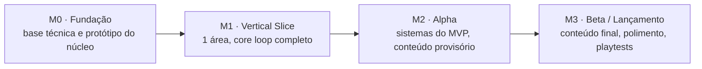

# Roadmap

Marcos são resultados, não datas: cada um termina com algo jogável e verificável. As datas entram quando houver velocidade medida, depois de 2 ou 3 sprints.

| Marco | Saída esperada | Situação |
| --- | --- | --- |
| M0 · Fundação | Fundação pronta (Rojo, GitHub, lint, formatação, CI, convenções e um exemplo cliente↔servidor validado) e o núcleo provado no PC: protótipo de combate, movimento e câmera e spike de desempenho do terreno ([EP-001](epicos/EP-001-base-tecnica-e-prototipo-do-nucleo.md)) | Em andamento |
| M1 · Vertical Slice | Um pedaço pequeno do jogo com qualidade próxima da final, que prova que o core loop é divertido (cerca de 30 minutos de jogo) | Corte aprovado em 04/11 (só PC, região de Stardawn); épicos EP-002 a EP-012 criados em 05/11 |
| M2 · Alpha | Todos os sistemas do MVP, com conteúdo provisório | — |
| M3 · Beta / Lançamento | Conteúdo final, polimento e playtests | — |

Os épicos de cada marco aparecem no [BACKLOG.md](BACKLOG.md). O corte aprovado do M1 está na aba [Visão do Jogo](https://claude.ai/artifact/J9zY7LF95U87AhXJN5X6iQ) do doc de design, e os épicos dele (EP-002 a EP-012) estão em `epicos/`. Os candidatos de M2 em diante ainda não viraram arquivos:

| # | Épico candidato | Marco | Depende de |
| --- | --- | --- | --- |
| EP-013 | Mercado entre jogadores | M2 | EP-004, EP-006 |
| EP-014 | Flag PvP e reputação | M2 | EP-009 |
| EP-015 | Dungeon corrompida | M2 | EP-010, EP-014 |
| EP-016 | Grupo e guildas | M3 | EP-012 |
| EP-017 | Monetização (VIP e cosméticos) | M3 | EP-004 |
| EP-018 | Versão para celular (controles e UI) | a definir | EP-002, EP-011 |
