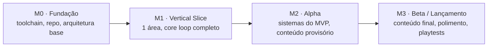

# Roadmap

Marcos são resultados, não datas: cada um termina com algo jogável e verificável. As datas entram quando houver velocidade medida, depois de 2 ou 3 sprints.

| Marco | Saída esperada | Situação |
| --- | --- | --- |
| M0 · Fundação | Projeto sincronizando com o Studio via Rojo, versionado no GitHub, com lint, formatação, CI e convenções documentadas; um exemplo cliente↔servidor rodando | Em andamento |
| M1 · Vertical Slice | Um pedaço pequeno do jogo com qualidade próxima da final, que prova que o core loop é divertido (cerca de 30 minutos de jogo) | Corte proposto, aguardando aprovação |
| M2 · Alpha | Todos os sistemas do MVP, com conteúdo provisório | — |
| M3 · Beta / Lançamento | Conteúdo final, polimento e playtests | — |

Os épicos de cada marco aparecem no [BACKLOG.md](BACKLOG.md). A proposta de corte do M1 e a lista de épicos candidatos estão na aba [Revisão 03/11](https://claude.ai/artifact/J9zY7LF95U87AhXJN5X6iQ#08849064-3647) do doc de design, e viram arquivos em `epicos/` quando forem aprovadas.
