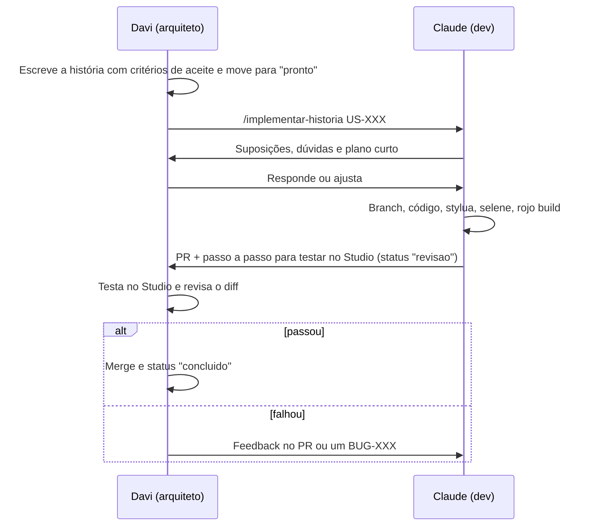

# Como trabalhar com o Claude

| Papel | Quem | Faz |
| --- | --- | --- |
| Engenheiro de software e arquiteto | Davi | Define visão e prioridades, escreve épicos e histórias, toma as decisões (ADRs), revisa e aceita |
| Dev | Claude | Propõe opções técnicas, implementa histórias, escreve testes e documentação técnica, aponta riscos e dúvidas antes de codar |

## Onde cada coisa acontece
- **Design do jogo:** no [doc de design](https://claude.ai/artifact/J9zY7LF95U87AhXJN5X6iQ), no Claude Docs. É lá que a Visão, os Pilares e os Sistemas são discutidos e editados, inclusive por comentários.
- **Código e planejamento de engenharia:** neste repositório, pelo Claude Code. O Claude lê e escreve os arquivos direto e roda `stylua`, `selene`, `rojo build` e `tools/backlog.py`.

## Ciclo de uma história

## Skills do projeto (Claude Code)
| Comando | Para quê |
| --- | --- |
| `/implementar-historia US-XXX` | Implementa uma história seguindo o processo inteiro |
| `/nova-historia <título>` | Cria uma história com o próximo ID livre, a partir do template |
| `/novo-adr <decisão>` | Registra uma decisão técnica com o próximo número livre |

Também dá para pedir em português normal ("implemente a US-005"): o Claude Code reconhece a skill pela descrição.

## Regras de ouro
1. **Uma história por vez.** Pedidos grandes geram código grande e difícil de revisar.
2. **Critério de aceite primeiro.** Sem ele, não há como saber se está pronto.
3. **Decisão difícil vira ADR,** mesmo que curto.
4. **Revise o diff.** O Davi é o responsável técnico. O Claude erra, e também precisa dizer quando não tem certeza.
